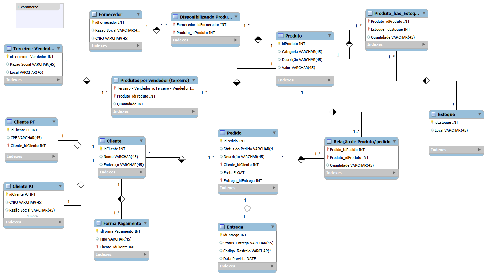

# Modelo-Relacional-para-E-commerce

Este repositório contém a modelagem de um banco de dados para um sistema de E-commerce, desenvolvido como projeto universitário. O foco principal do modelo é garantir a integridade dos dados e aplicar regras de negócio fundamentais para o comércio eletrônico.

## 📊 Diagrama do Banco de Dados

## ⚙️ Regras de Negócio Refinadas

O modelo foi estruturado para atender aos seguintes requisitos do sistema:
- **Especialização de Clientes (PF e PJ):** Uso de herança (relacionamento 1:1) para separar contas de Pessoa Física (CPF) e Pessoa Jurídica (CNPJ), evitando inconsistências de dados na entidade principal.
- **Múltiplos Métodos de Pagamento:** Estrutura 1:N que permite ao cliente cadastrar e gerenciar diversas formas de pagamento.
- **Gestão de Entrega:** Entidade dedicada e vinculada aos pedidos, criada para registrar obrigatoriamente o status de envio e o código de rastreio.
- **Estoque e Fornecedores:** Relacionamentos que controlam a disponibilidade de produtos, tanto de estoque próprio quanto de vendedores terceiros.

## 🛠️ Ferramenta Utilizada
- MySQL Workbench
